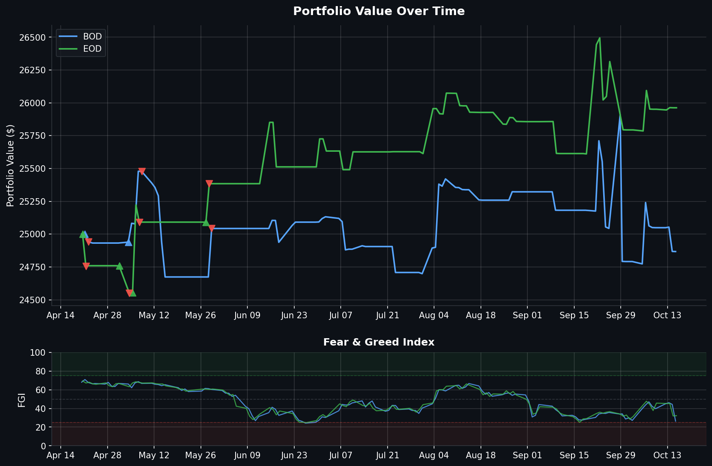

# Fear & Greed Index Trading Bot

> Dashboard auto-updated daily at market close | Last update: **2026-10-16 13:30 PST**

---

## BOD (Morning) Strategy

| Metric | Value |
|--------|-------|
| Portfolio Value | **$24,867.22** |
| Buying Power | $99,468.88 |
| Current FGI | 30.69 |
| Position | FLAT |
| Total P&L | **$+995** |
| Win Rate | 50% (1W / 1L) |
| Total Round Trips | 2 |
| Last Signal | NO_ACTION @ 2026-10-16 09:35 |

Trade History (2 trades)

| Buy Date | Sell Date | Buy Price | Sell Price | Qty | P&L | Return | Result |
|----------|-----------|-----------|------------|-----|-----|--------|--------|
| 2026-04-21 | 2026-04-22 | $710.20 | $709.24 | 70 | $-68 | -0.14% | LOSS |
| 2026-05-04 | 2026-05-08 | $719.65 | $735.05 | 69 | $+1,063 | +2.14% | WIN |

Recent Activity (last 5 entries)

| Time | Action | Price | FGI | Momentum | Velocity | Volatility | Reason |
|------|--------|-------|-----|----------|----------|------------|--------|
| 10-16 09:35 | NO_ACTION | $772.30 | 30.69 | -3.11 | -5.14 | 0.0963 | Insufficient momentum/velocity for entry |
| 10-15 09:35 | NO_ACTION | $765.60 | 26.43 | -12.51 | -6.19 | 0.0978 | Insufficient momentum/velocity for entry |
| 10-14 09:35 | NO_ACTION | $775.04 | 44.29 | -0.84 | 1.52 | 0.0957 | SELL incomplete - still holding 62 after 5 attempts |
| 10-13 09:36 | NO_ACTION | $777.67 | 46.11 | 2.49 | 1.33 | 0.0964 | BUY did not fill after 3 attempts |
| 10-12 09:35 | NO_ACTION | $778.58 | 45.0 | 2.72 | -0.69 | 0.0982 | Insufficient momentum/velocity for entry |

---

## EOD (Afternoon) Strategy

| Metric | Value |
|--------|-------|
| Portfolio Value | **$25,962.41** |
| Buying Power | $103,849.64 |
| Current FGI | 17.82 |
| Position | FLAT |
| Total P&L | **$+302** |
| Win Rate | 50% (2W / 2L) |
| Total Round Trips | 4 |
| Last Signal | NO_ACTION @ 2026-10-16 15:50 |

Trade History (4 trades)

| Buy Date | Sell Date | Buy Price | Sell Price | Qty | P&L | Return | Result |
|----------|-----------|-----------|------------|-----|-----|--------|--------|
| 2026-04-20 | 2026-04-21 | $708.76 | $704.15 | 70 | $-323 | -0.65% | LOSS |
| 2026-05-01 | 2026-05-04 | $720.42 | $717.38 | 68 | $-207 | -0.42% | LOSS |
| 2026-05-05 | 2026-05-07 | $723.86 | $731.90 | 67 | $+539 | +1.11% | WIN |
| 2026-05-27 | 2026-05-28 | $750.78 | $755.22 | 66 | $+293 | +0.59% | WIN |

Recent Activity (last 5 entries)

| Time | Action | Price | FGI | Momentum | Velocity | Volatility | Reason |
|------|--------|-------|-----|----------|----------|------------|--------|
| 10-16 15:50 | NO_ACTION | $762.83 | 17.82 | -9.53 | -9.16 | 0.106 | Insufficient momentum/velocity for entry |
| 10-15 15:50 | NO_ACTION | $771.67 | 32.26 | -4.25 | -4.35 | 0.0968 | Insufficient momentum/velocity for entry |
| 10-14 15:50 | NO_ACTION | $768.97 | 31.96 | -8.90 | -4.57 | 0.1052 | Insufficient momentum/velocity for entry |
| 10-13 15:50 | NO_ACTION | $778.38 | 45.31 | -0.12 | 2.51 | 0.0962 | SELL incomplete - still holding 66 after 5 attempts |
| 10-12 15:51 | NO_ACTION | $777.98 | 45.31 | 2.40 | 0.37 | 0.0984 | BUY did not fill after 3 attempts |

---

## Strategy

Momentum-based strategy using CNN Fear & Greed Index to trade SPY.

| Parameter | Value |
|-----------|-------|
| Momentum Threshold | 0.2 |
| Velocity Threshold | 0.15 |
| Volatility Buy Limit | 0.6 |
| Volatility Sell Limit | 0.5 |
| Max Days Held | 8 |
| Lookback Days | 3 |
| BOD Execution | 6:20 AM PST |
| EOD Execution | 1:10 PM PST |
